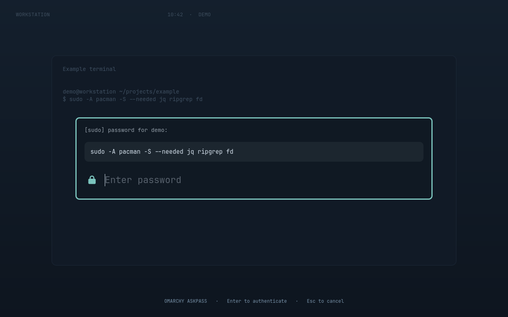

# Omarchy Askpass

A native Quickshell password overlay for `sudo -A`, with the **complete command**
shown before you type. Uses Omarchy's Polkit colors, typography, borders and scrim.

Especially useful for **AI coding agents working on your own Omarchy machine**:
when an agent needs sudo without an interactive terminal, you can inspect the
command and enter your password directly in the desktop overlay.



- Full argument list, including quoted arguments and multiline shell scripts.
- Selectable, copyable command text; wrapping and scrolling instead of truncation.
- Enter to submit, Escape to cancel. Concurrent requests are queued.
- One plugin repository contains both the QML overlay and Bash askpass helper.
- No sudoers changes, passwordless sudo rules or background network access.

## Install

Requires **Omarchy Quattro / 4.x**, its running Quickshell shell, Linux `/proc`,
Bash 4.4+, GNU coreutils and util-linux (`flock`). These are normally present on
Omarchy. The helper must run as your desktop user, not as root.

```bash
omarchy plugin add https://github.com/FLX-0x00/omarchy-askpass.git --enable
```

Add this line to your shell configuration (`~/.bashrc` for Bash), then open a new
terminal or run the same line in the current one:

```bash
export SUDO_ASKPASS="$HOME/.config/omarchy/plugins/io.github.flx-0x00.askpass/bin/askpass"
```

This manual step is intentional: Omarchy's installer does not execute install
hooks, and the plugin does not edit your shell configuration.

## Use

```bash
sudo -A -- /usr/bin/id -u
OMARCHY_ASKPASS_REASON='Install development tools' sudo -A pacman -S --needed jq ripgrep
```

`SUDO_ASKPASS` selects the helper; **`-A` selects graphical authentication**.
Normal terminal sudo continues to work normally. A valid sudo timestamp skips
authentication, so this is not a per-command approval system. The overlay shows
sudo's argv, not a dry run of scripts or programs that the command may execute.

Optional environment variables:

| Variable | Default | Purpose |
| --- | --- | --- |
| `OMARCHY_ASKPASS_REASON` | sudo's prompt | Short heading above the command. |
| `OMARCHY_ASKPASS_TIMEOUT` | `120` | Positive integer seconds for queue/response waits. The overlay also expires after 120 seconds. |

### Local AI coding agents

Coding agents such as OpenCode, Claude Code or Codex often run shell commands
without a TTY, so a normal sudo password prompt cannot be answered there.
Askpass provides a desktop prompt while the agent waits for its command to finish.
The agent does not need to ask for your password in chat or handle it itself.

Launch your agent from a terminal with `SUDO_ASKPASS` exported as above, so it
inherits the helper path and your desktop-session environment. Tell it to use
`sudo -A` for commands that require elevation. It can optionally add a short reason:

```bash
OMARCHY_ASKPASS_REASON='Check the effective user' sudo -A -- /usr/bin/id -u
```

When authentication is needed, inspect the full command, then enter your password
or press Escape to cancel. This uses normal sudo policy and timestamp caching;
it does not grant the agent unrestricted privileges or require `NOPASSWD`.

## Update and remove

```bash
omarchy plugin update io.github.flx-0x00.askpass
```

If an update changes an IPC signature or the running service retains old QML,
run `omarchy restart shell` once.

To remove, first delete the `SUDO_ASKPASS` export from your shell configuration:

```bash
unset SUDO_ASKPASS
omarchy plugin remove io.github.flx-0x00.askpass
```

Remove any optional compatibility symlink you created separately. The plugin
does not install one automatically.

## Security model

The helper reads the invoking sudo process's argument list. Passwords travel over
stdin and a private FIFO, never argv or environment variables, and are not
intentionally logged or saved to regular files. Request directories are `0700`;
FIFOs are `0600`. Cancellation and timeouts fail authentication.

**The desktop user and installed Shell plugins are trusted.** This is a
third-party UI in the shared Shell process, not the built-in Polkit agent or an
isolated authentication broker. Its IPC endpoint is not authenticated: another
process running as your user can imitate a request and its displayed command.
Private file permissions do not protect against malicious code running as the
same user. See [SECURITY.md](SECURITY.md) for the boundaries and reporting policy.

## Development

```bash
bash tests/helper.sh
omarchy plugin validate .
bash scripts/render-previews
```

Preview images render the actual `AskpassCard.qml` offscreen with a synthetic
desktop and example commands. They do **not** capture a real desktop, theme,
terminal history, hostname or password. See the [long-command preview](docs/long-command.png).

MIT licensed. Visual structure is adapted from Omarchy's MIT-licensed Polkit UI;
the runtime styling is provided by Omarchy's `qs.Commons` and `qs.Ui` modules.
